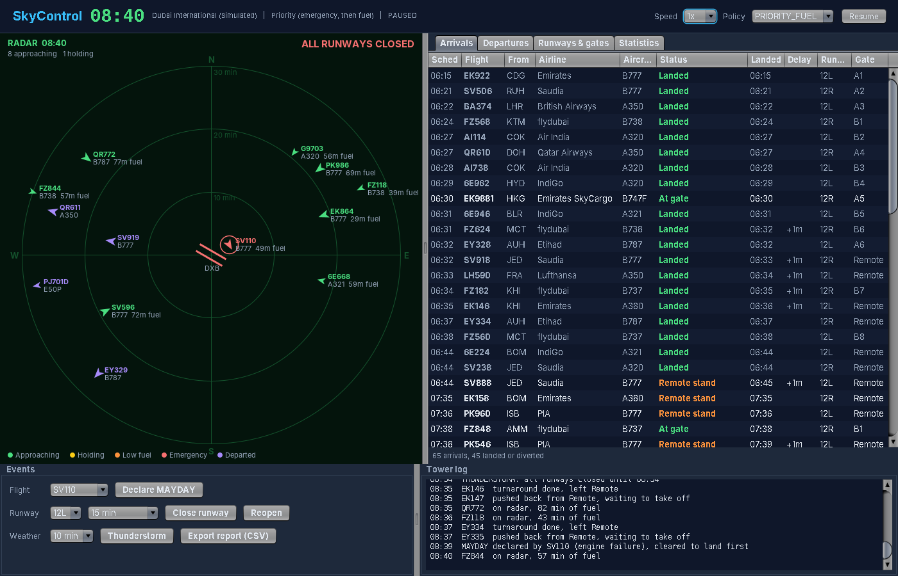

# SkyControl

An air traffic control and airport operations simulator written in Java for the Object Oriented Programming course project (BITS Pilani, Dubai Campus).

SkyControl simulates a busy two-runway airport, modelled on Dubai International, on a sped-up clock. Flights approach, wait their turn, land, park at gates, turn around and take off again. The program acts as the control tower: it decides who uses the runway next, keeps safe gaps between aircraft, assigns gates, and reacts live to emergencies, low fuel, runway closures and thunderstorms.

Airline names, airports and aircraft types are real. All flights, times and events are simulated.



## Features

- **Radar** with aircraft approaching along the bearing of their origin, circling while they wait, and departing. Low-fuel aircraft turn orange; emergencies flash red.
- **Arrivals and departures boards** like the screens in a terminal.
- **Runways and gates** view: runway status, the runway queue in clearance order, and all 14 gates.
- **Statistics**: landings, take-offs, average delays, on-time %, diversions, runway use, a movements-per-hour chart, and past runs loaded from the database.
- **Live events**: declare a MAYDAY, close or reopen a runway, start a thunderstorm.
- **Two scheduling policies**, switchable while running: first come first served, or priority (emergency, then lowest fuel, then arrival order).
- **Real aviation rules, simplified**: wake turbulence separation (a light jet waits longer behind a heavy one), low-fuel priority, diversion when fuel runs out, remote stands when no gate is free.
- **Saved runs**: every flight and log message is written to a SQLite database by a background thread.
- **CSV export** of flights and a summary report.
- **Policy experiment** that runs the same day under both policies on 5 seeds in parallel and compares them.

## How to run

You need **JDK 17 or newer**. Nothing else has to be installed: the SQLite driver is already in `lib/`.

| System | Start the application | Run the tests | Run the experiment |
|---|---|---|---|
| Windows | `run.bat` | `run-tests.bat` | `run-experiment.bat` |
| macOS / Linux | `./run.sh` | `./run-tests.sh` | `./run-experiment.sh` |

### Running from IntelliJ IDEA

1. Open the project folder.
2. Right-click `src` and choose **Mark Directory as > Sources Root**.
3. Right-click `lib/sqlite-jdbc-3.41.2.2.jar` and choose **Add as Library**.
4. In **Run > Edit Configurations**, set the working directory to the project folder (so `data/schedule.csv` is found).
5. Open `src/Main.java` and click the green run arrow.

## Using the app

| Control | What it does |
|---|---|
| Speed (top right) | 1x = one simulated minute per real second. Use 5x or 10x to skip quiet periods. |
| Policy (top right) | Switch between `PRIORITY_FUEL` and `FCFS` at any time. The queue reorders instantly. |
| Pause / Resume | Freezes the clock (useful while explaining something). |
| Declare MAYDAY | Pick any flight in the air; it jumps to the front of the queue (under the priority policy). |
| Close runway / Reopen | Closes 12L or 12R for 15 min, 30 min or until reopened. |
| Thunderstorm | Closes both runways for 10, 20 or 30 min. Aircraft circle and burn fuel; the lowest may divert to Abu Dhabi. |
| Export report (CSV) | Saves `flights_<time>.csv` and `summary_<time>.csv` in `data/exports/`. |

### Demo script (5 minutes)

1. Start at 2x speed. Point out the radar, the arrivals board and the tower log.
2. Around 06:30 the first wave lands. Show the **Runways & gates** tab: gates filling, widebodies at large `A` gates, overflow to remote stands.
3. Declare a **MAYDAY** for an approaching flight. It turns red and lands next.
4. Start a **20-minute thunderstorm**. Aircraft stack up in the holding ring, fuel runs down, low-fuel ones turn orange and move to the front of the queue.
5. Switch the policy to **FCFS** during the storm and show the low-fuel flights dropping back in the queue, then switch back.
6. Open **Statistics** to show delays, diversions and the hourly chart, then **Export report**.
7. Finish with the experiment results (below).

## Project structure

Every folder holds one kind of class.

```
src/
  Main.java        starts everything: schedule, database, clock thread, window
  model/           the things at an airport: Aircraft and its 4 types, Flight, Runway, Gate,
                   Airport, enums (status, priority, wake category, gate size), separation rules
  policy/          SchedulingPolicy interface and its two policies
  engine/          ControlTower (runs the simulation), RunwayScheduler, GateAllocator,
                   SimClock (clock thread), TrafficGenerator, FlightListener (observer)
  events/          Event interface and the events: MAYDAY, runway closure/reopen, storm
  exceptions/      the custom exceptions, all extending SkyControlException
  data/            schedule CSV loader, Storage interface, SQLite (JDBC) and in-memory storage,
                   background database writer
  report/          Statistics and CSV report export
  gui/             Swing screens: main window, radar, boards, runways & gates, statistics,
                   event controls, tower log
  experiment/      FCFS vs priority experiment (runs scenarios in parallel)
  test/            test suites and a console demo
lib/               SQLite JDBC driver
data/              schedule.csv (input), skycontrol.db and exports/ (created when you run)
docs/              class guide, glossary, screenshots
```

[docs/CLASSES.md](docs/CLASSES.md) lists every class, what it does and which OOP concept it shows. [docs/GLOSSARY.md](docs/GLOSSARY.md) explains the aviation terms.

## Where each OOP concept is used

| Concept | Where |
|---|---|
| Inheritance and abstract classes | `Aircraft` → `Narrowbody`, `Widebody`, `Cargo`, `BusinessJet`; `SkyControlException` → 6 exceptions |
| Polymorphism | Each aircraft type returns its own wake category, runway time, gate size and turnaround, so the scheduler and gate allocator never check types. Policies, events, storages and screens are all used through their interfaces. |
| Interfaces | `SchedulingPolicy`, `Event`, `Storage`, `FlightListener`, `Refreshable` |
| Encapsulation | `Flight` controls its own fuel and priority (`burnFuel`, `declareEmergency`); screens only ever see read-only `FlightSnapshot` records |
| Custom exceptions | `RunwayClosedException`, `GateUnavailableException`, `InsufficientFuelException`, `InvalidFlightPlanException`, `InvalidEventException`, `StorageException`. Each one leads to a visible result (diversion, remote stand, message on screen). |
| Collections | `PriorityQueue` (runway queue), `LinkedHashMap` (flights by number), `EnumMap` (gates by size), `TreeMap` (movements by hour), `ArrayDeque` (tower log), `BlockingQueue` (database writer), `CopyOnWriteArrayList` (listeners) |
| Multithreading | Clock thread; background database writer (producer-consumer); Swing timer on the event thread; thread pool in the experiment; `synchronized` tower and scheduler |
| Design patterns | Observer (`FlightListener`), Strategy (`SchedulingPolicy`), Factory (`Aircraft.of`), Command (`Event`), Snapshot / immutable view (`TowerSnapshot`) |
| File handling | Schedule read from CSV; reports and experiment results written to CSV |
| JDBC | `SqliteStorage`: tables for runs, flights and events, with prepared statements |
| Enums | `FlightStatus`, `Priority`, `WakeCategory`, `GateSize`, `FlightType` (some with their own fields and methods) |
| Records | `FlightSnapshot`, `TowerSnapshot`, `LogEntry`, `ScenarioResult`, `RunSummary`, `ScheduledFlight` |

## Tests

| Suite | What it checks | Checks |
|---|---|---|
| `test.SchedulerTest` | aircraft types, flight validation, fuel, separation gaps, both policies, MAYDAY, two runways, closed runways, policy switching | 57 |
| `test.SimulationTest` | full flight life cycle, gates, remote stands, low fuel, storms and diversions, events, generated traffic, statistics | 65 |
| `test.DataTest` | schedule loader (good and bad files), SQLite and in-memory storage, data surviving a restart, background writer, CSV export | 42 |
| `test.ConcurrencyTest` | 5 threads at once (clock, 2 firing events, 2 reading): no double landings, no double-booked gates; clock pause/resume/stop; experiment repeatable | 12 |
| **Total** | | **176** |

`test.ConsoleDemo` prints a step-by-step walkthrough of the runway scheduler without the GUI.

## Experiment: does the priority policy help?

`experiment.PolicyExperiment` runs the same busy day (full schedule, extra random traffic, a 25-minute storm at 07:30, a MAYDAY at 08:00 and runway 12R closed at 08:40) under both policies, with 5 random seeds, on a thread pool.

| Policy | Diversions per day | Avg arrival delay | Avg departure delay | On time |
|---|---|---|---|---|
| FCFS | 5.6 | 4.4 min | 3.9 min | 87% |
| PRIORITY_FUEL | **3.2** | 4.8 min | 4.8 min | 84% |

The priority policy cuts diversions by about 43%, at the cost of slightly higher average delay. FCFS's lower average delay is partly an illusion: the flights it diverts are the ones that waited longest, and diverted flights are not counted in the landing delay.

## Limitations

- Time moves in whole minutes, and taxiing is not modelled.
- Both runways handle landings and take-offs (real DXB usually uses one for each).
- Fuel is measured in minutes of flying time, not tonnes.
- Separation gaps are simplified from the real distance-based rules.
